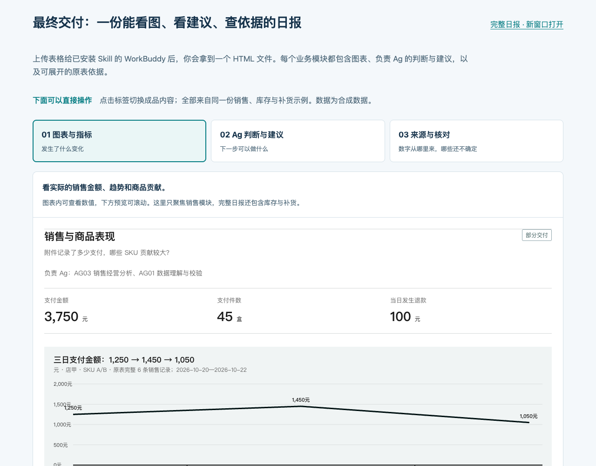

# 电商日报助手

**把电商表格变成一份能看图、看建议、查依据的 HTML 日报。**

23 个电商 Ag 角色方法、10 类日报适配，集成在一个 Skill 中。适合电商业务人员和培训者：在 WorkBuddy 中上传表格、说清问题，由助手按需分析并交付可离线打开的日报。

[先看互动成果](https://2802009723-create.github.io/ecommerce-report-skills/#deliverables) · [安装与开始使用](https://2802009723-create.github.io/ecommerce-report-skills/install.html) · [下载 v1.2.1](https://github.com/2802009723-create/ecommerce-report-skills/releases/tag/v1.2.1) · [浏览 23 个角色](https://2802009723-create.github.io/ecommerce-report-skills/roles.html)

[](https://2802009723-create.github.io/ecommerce-report-skills/#deliverables)

*点击图片进入互动展示。截图与演示均为合成数据，不代表真实经营结果。*

## 先体验，你会拿到什么

最终交付是一个 HTML 日报文件。首页可切换查看同一份成品的三个部分：

| 查看方式 | 能看到什么 | 帮你回答什么 |
| --- | --- | --- |
| **图表与指标** | 支付金额、销售趋势、商品贡献等实际图表 | 发生了什么变化？ |
| **Ag 判断与建议** | 负责角色、主要发现、建议动作、理由与验证方法 | 下一步可以做什么？ |
| **来源与核对** | 原表范围、计算口径、缺失条件和复核记录 | 数字从哪里来，哪些还不确定？ |

预览内可以滚动、展开依据，也可以[打开整份示例日报](https://2802009723-create.github.io/ecommerce-report-skills/demo.html)。完整示例包含销售、库存与补货参考；缺少交期、在途等条件时，采购量保留“待确认”。

## 选择你的入口

| 入口 | 用来做什么 |
| --- | --- |
| [互动成果演示](https://2802009723-create.github.io/ecommerce-report-skills/#deliverables) | 安装前先看交付效果；切换视图不会调用 AI |
| [任务书生成器](https://2802009723-create.github.io/ecommerce-report-skills/generator.html) | 编辑分析问题、模块和口径，导出自己的任务书 |
| **WorkBuddy 中的电商日报助手 Skill** | 接收表格与需求，完成实际分析、图表、建议和复核 |

网页不上传底表、不执行模型分析。安装 Skill 后，复杂需求只需提交**任务书＋原表**，角色库与 HTML 模板已内置。

## 三步开始

1. [下载 Skill 安装 ZIP](https://github.com/2802009723-create/ecommerce-report-skills/releases/download/v1.2.1/ecommerce-daily-report-v1.2.1.zip)。
2. 在 WorkBuddy 的“专家·技能·连接器 → 技能 → 添加技能 → 上传技能”中安装（入口名称可能随客户端版本调整）。
3. 新建任务、上传 Excel / CSV / TSV，发送：

> 用电商日报助手分析这些表格，生成带图表和行动建议的日报。重点看销售、库存和补货；没有依据的内容标待确认。

第一次使用可先[下载演示表格与参考日报](https://github.com/2802009723-create/ecommerce-report-skills/releases/download/v1.2.1/sample-tables-and-report.zip)，按[安装说明中的核对答案](https://2802009723-create.github.io/ecommerce-report-skills/install.html)检查结果，再换成自己的表格。

## 下载哪个包

| 文件 | 适合谁 | 怎么用 |
| --- | --- | --- |
| [ecommerce-daily-report-v1.2.1.zip](https://github.com/2802009723-create/ecommerce-report-skills/releases/download/v1.2.1/ecommerce-daily-report-v1.2.1.zip) | 准备用 WorkBuddy 分析表格的人 | 在技能管理中上传此 ZIP |
| [ecommerce-report-offline.zip](https://github.com/2802009723-create/ecommerce-report-skills/releases/download/v1.2.1/ecommerce-report-offline.zip) | 想离线演示、培训或浏览框架的人 | 解压后打开 `index.html` |
| [sample-tables-and-report.zip](https://github.com/2802009723-create/ecommerce-report-skills/releases/download/v1.2.1/sample-tables-and-report.zip) | 想先测试流程的人 | 解压取得两份合成 CSV 和参考 HTML |

GitHub 自动生成的 **Source code ZIP 是整个仓库源码，不是 Skill 安装包**。下载文件可用 [SHA256SUMS.txt](https://github.com/2802009723-create/ecommerce-report-skills/releases/download/v1.2.1/SHA256SUMS.txt) 核对。

## v1.2.1 更新

- 成果展示由静态截图升级为三个可操作的真实日报视图。
- 清楚标注最终交付、合成示例、完整日报与任务书配置入口。
- 同步离线体验包，已检查电脑和手机布局、视图切换、来源展开及公开下载文件。

本次主要改善展示与使用说明，**角色方法未变，已安装 v1.2.0 的用户可以继续使用**。完整历史见 [CHANGELOG](CHANGELOG.md)。

## 覆盖哪些电商场景

经营总览、店铺运营、商品表现、广告投放、库存补货、客服售后、利润结算、大促活动、直播运营、新品跟进。

协作流程：**AG01 数据校验 → 相关业务角色 → AG05 图表与交付 → AG23 复核 → 修正与交付。**

每个模块默认最多三项主要发现、两项优先建议，详细依据折叠展示。只有可靠的时间序列才画趋势，未知不填零，事实、推断与待确认项分开。

23 个角色是可调用的方法与提示词，不是 23 个训练好的模型。环境支持时可分工；否则由同一助手分阶段执行，并如实说明复核方式。[完整角色索引](skills/ecommerce-daily-report/references/role-index.md)。

## 当前运行条件与验证范围

| 项目 | 说明 |
| --- | --- |
| 模型与工具 | 使用 WorkBuddy 当前账号的模型、文件和计算权限；本项目不提供模型额度 |
| Python | 内置读表与渲染脚本使用 Python 3 标准库，优先复用现有运行时 |
| 表格 | XLSX / CSV / TSV；旧 XLS、加密表需转换；公式需核对重算或提供值表 |
| 数据与更新 | HTML 是数据快照，新表需重新生成；已安装 Skill 不会随 GitHub 发布自动升级 |
| 已检查 | 安装包结构、合成示例计算、网页与离线交互、电脑及手机布局、线上下载一致性 |
| 仍需试跑 | 不同 WorkBuddy 版本、全部角色的真实业务任务，以及建议的实际适用性 |

数据在 AI 执行时如何传输和保留，遵循你使用的平台规则。离线 HTML 展示不代表分析全程离线。[查看检查范围](https://2802009723-create.github.io/ecommerce-report-skills/validation.html)。

## 给开发者

```sh
# 用固定的合成表格复现图表，不调用模型
python3 examples/sales-inventory/reproduce.py

# 校验公开文件、安装包与示例计算
python3 scripts/check_release.py

# 从当前源码重新打包
python3 scripts/package_release.py
```

示例输出到 `examples/sales-inventory/generated/`，再次运行前移走旧的 `report.html`。这个脚本只处理附带的固定示例；任意业务表格分析依赖 Skill 与 AI 执行环境。

```text
skills/ecommerce-daily-report/  技能、角色方法、读表脚本、HTML 模板
docs/                          在线体验和下载入口
examples/sales-inventory/       合成表格、核对答案、复现脚本
scripts/                       打包与发布检查
media/                         项目介绍截图
```

GitHub Pages 使用 `main` 分支的 `/docs` 目录，无需 Node 构建或常驻服务。

## 反馈与贡献

如果它帮你解决了实际问题，欢迎点 Star，也欢迎提交试用反馈。Issue 请附客户端版本、复现步骤和合成或脱敏数据，不要上传真实敏感经营资料。[贡献说明](CONTRIBUTING.md) · [问题反馈](https://github.com/2802009723-create/ecommerce-report-skills/issues)

项目自有内容采用 [MIT](LICENSE)。图表组件来自 Raghuram Sirigiri 的 chart-dashboard / charts-lib，保留上游版权与许可，见 [第三方来源](THIRD_PARTY_NOTICES.md)。本项目不是 WorkBuddy 或 GitHub 官方产品。

## English

An experimental ecommerce reporting Skill with 23 role methods and 10 report types. Turn spreadsheets into offline HTML reports with charts, concise recommendations and traceable evidence. [Try the interactive deliverables preview](https://2802009723-create.github.io/ecommerce-report-skills/#deliverables): switch between charts, Ag recommendations and source/review records. The website previews results and creates analysis briefs; actual analysis runs in WorkBuddy. Start with the synthetic example. Python 3 is required for bundled tools; real-world and cross-client coverage is still being validated.
