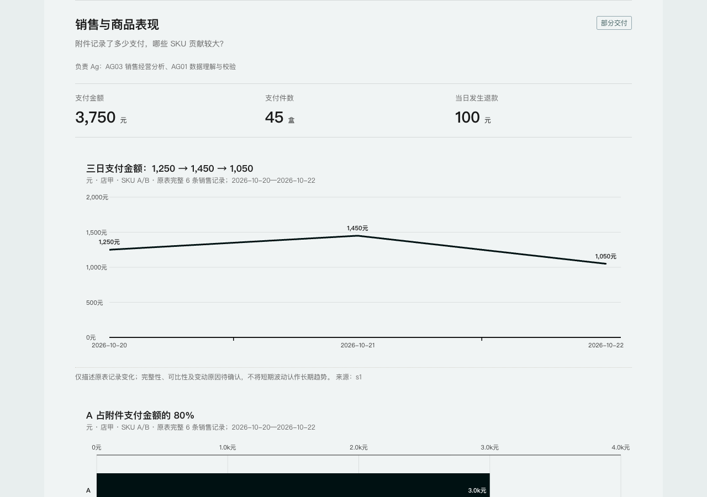

# 电商日报助手

**让 Excel 变成有图表、有建议、可核对的经营日报。**

23 个电商 Ag 角色方法，10 类日报适配，集成在一个 Skill 中。面向业务人员与培训者：上传表格、说清需求，在支持技能与文件工具的 AI 工作环境中生成可离线打开的 HTML 日报。

[在线体验](https://2802009723-create.github.io/ecommerce-report-skills/) · [下载技能安装包](https://github.com/2802009723-create/ecommerce-report-skills/releases/download/v1.2.0/ecommerce-daily-report-v1.2.0.zip) · [演示表格与结果](https://2802009723-create.github.io/ecommerce-report-skills/downloads/sample-tables-and-report.zip) · [使用说明](https://2802009723-create.github.io/ecommerce-report-skills/install.html)



> 公开试用版。截图和演示均为合成数据；不是任何企业的真实经营结果。网页生成任务书，AI 分析在 WorkBuddy 中执行。

## 三步开始

1. 下载 **ecommerce-daily-report-v1.2.0.zip**。不要用 GitHub 自动提供的整个仓库 Source code ZIP 安装技能。
2. 在 WorkBuddy 的“专家·技能·连接器 → 技能 → 添加技能 → 上传技能”中安装 ZIP（入口可能随版本变化）。
3. 新建任务，上传 Excel / CSV / TSV，发送：

> 用电商日报助手分析这些表格，生成带图表和行动建议的日报。重点看销售、库存和补货；没有依据的内容标待确认。

没有表格可先用 [两份合成 CSV](examples/sales-inventory/input)。对照 [示例核对答案](examples/sales-inventory/README.md)，判断结果有没有算对。

复杂需求可以先打开任务书生成器，编辑模块、指标和个人要求，再把导出的任务书与表格交给已安装的 Skill。**无需再上传一遍角色库和模板。**

## 你会得到什么

- 有可靠时间序列时画趋势图，有类别维度时画对比图；不为了出图编造数据。
- 每块显示负责 Ag、指标、最多三项主要发现、两项优先建议。
- 来源、公式和明细折叠展示；需要时可以回查。
- 缺口保留“待确认”，区分事实、推断和建议。
- 交付 HTML 静态快照，便于离线打开、分享和存档。

## 适用场景

经营总览、店铺运营、商品表现、广告投放、库存补货、客服售后、利润结算、大促活动、直播运营、新品跟进。

角色流程：**AG01 数据校验 → 相关业务角色 → AG05 图表与交付 → AG23 复核 → 修正与交付。**

23 个角色是可调用的方法与提示词，不是 23 个训练好的模型。工具支持时可多智能体分工，否则同一助手分阶段执行，并说明复核方式。完整角色见 [角色索引](skills/ecommerce-daily-report/references/role-index.md)。

## 当前边界

| 项目 | 说明 |
| --- | --- |
| WorkBuddy | 按其技能目录结构打包；不同客户端和真实表格仍需试跑 |
| 运行时 | 内置读表和渲染脚本使用 Python 3 标准库；需要宿主可用的文件/计算工具 |
| 模型 | 使用宿主账号的模型和额度，本项目不提供额度或绕过计费 |
| 文件 | XLSX / CSV / TSV；旧 XLS、加密表需转换；公式需核对重算或提供值表 |
| 网页 | 浏览器内配置需求，不接入模型、不上传底表；AI 执行时遵循宿主的数据规则 |
| 更新 | 新数据需重新生成日报，已安装 Skill 不会自动更新 |
| 验证 | 已检查结构、合成示例计算及网页呈现；未宣称全部角色和真实业务都验证通过 |

## 给开发者

```sh
# 不调用模型，用固定的合成表格复现图表
python3 examples/sales-inventory/reproduce.py

# 校验发布包、示例与公开文件
python3 scripts/check_release.py

# 按当前源码重新打包
python3 scripts/package_release.py
```

示例输出到 `examples/sales-inventory/generated/`，再次运行前移走旧的 `report.html`。示例脚本只处理附带的固定数据；任意业务表格分析依赖 Skill 和 AI 执行环境。

```text
skills/ecommerce-daily-report/  技能、角色方法、读表脚本、HTML 模板
docs/                          在线体验和下载入口
examples/sales-inventory/       合成表格、核对答案、复现脚本
scripts/                       发布包生成与检查
```

GitHub Pages 使用 `main` 分支的 `/docs` 目录，无需 Node、打包框架或常驻服务。完整角色可[在线检索](https://2802009723-create.github.io/ecommerce-report-skills/roles.html)。源码在 Git 中维护；安装包及离线包同时放在版本 Releases 中。下载可用 [SHA256SUMS.txt](docs/downloads/SHA256SUMS.txt) 校验。

## 反馈与贡献

如果项目帮你解决了问题，欢迎点 Star，也欢迎提交真实的试用反馈。Issue 请附客户端版本、复现步骤与**合成或脱敏**数据。不要提交真实敏感经营资料。[贡献说明](CONTRIBUTING.md) · [更新记录](CHANGELOG.md)

项目自有内容采用 [MIT](LICENSE)。图表组件来自 Raghuram Sirigiri 的 chart-dashboard / charts-lib，保留上游 MIT 版权与声明，见 [第三方来源](THIRD_PARTY_NOTICES.md)。本项目不是 WorkBuddy 或 GitHub 官方产品。

## English

An experimental ecommerce reporting Skill with 23 role methods and 10 report types. Use your AI host to analyze spreadsheets and produce offline HTML reports with charts, concise recommendations and traceable calculations. The browser tool creates an editable analysis brief; it does not run AI. Start with the synthetic sales/inventory example. Python 3 is required for the bundled tools. Cross-client and real-world coverage is still being validated.
